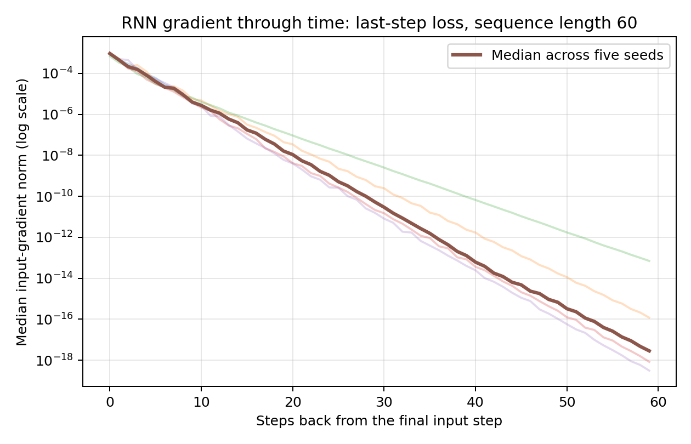

# What Recurrence Can and Cannot Remember

## Setup

At time step 0, the first four input features encode one of four class labels as a one-hot vector. Later time steps contain noise. The model must predict the original label from the final time step. Random guessing has an accuracy of **0.25 (25%)**.

The starter file `lab04_starter.py` provides the batch generator, recurrent model, and training loop. The experiments are implemented in `lab04.py`; they can also be run cell by cell from `lab04_notebook.ipynb`.

### Environment

```bash
python -m venv .venv
# Windows PowerShell:
.venv\Scripts\Activate.ps1
# macOS/Linux:
# source .venv/bin/activate
python -m pip install -r requirements.txt
```

## Run the experiments

Run all four pieces:

```bash
python lab04.py all
```

Or run one piece at a time:

```bash
python lab04.py benchmark
python lab04.py gradients
python lab04.py fixes
python lab04.py timing
```

Alternatively, open `lab04_notebook.ipynb` in Jupyter or VS Code and run the cells from top to bottom. The script writes CSV files to `results/` and the gradient plot to `figures/gradient_through_time.png`.

## Experimental controls

Unless the clipping comparison explicitly disables clipping, training comparisons use the same data generator, validation seed (999), 600 updates, Adam optimizer, learning rate 0.003, batch size 64, and clipping threshold 1.0. Each run uses the listed seed, with a training generator seeded by `seed + 100`. Benchmark and fixes experiments use seeds 0, 1, and 2; the gradient experiment uses seeds 0–4. Benchmark sequence lengths are 10, 30, and 60.

## Prediction (recorded before the clipping comparison)

**Prediction:** At sequence length 30, clipping gradients at 1.0 may make training more stable by limiting unusually large updates. However, it may not improve accuracy if the main difficulty is vanishing gradients rather than exploding gradients. Disabling clipping could help, do nothing, or hurt; the outcome below is reported as measured.

## Results

Accuracy is reported for every seed. “Above chance” is accuracy minus 0.25; a positive value means performance above random guessing. The CSV files contain the raw measurements.

### 1. Recurrent-cell benchmark

Each cell below lists validation accuracy for seeds 0, 1, and 2, followed by the mean and the mean's difference from chance.

| Configuration | Length | Seed 0 | Seed 1 | Seed 2 | Mean accuracy | Mean above chance |
|---|---:|---:|---:|---:|---:|---:|
| RNN | 10 | 1.000 | 1.000 | 0.495 | 0.832 | +0.582 |
| LSTM-default | 10 | 1.000 | 1.000 | 1.000 | 1.000 | +0.750 |
| GRU-default | 10 | 1.000 | 1.000 | 1.000 | 1.000 | +0.750 |
| LSTM-forget-bias-1 | 10 | 1.000 | 1.000 | 1.000 | 1.000 | +0.750 |
| GRU-update-bias-1 | 10 | 1.000 | 1.000 | 1.000 | 1.000 | +0.750 |
| RNN | 30 | 0.248 | 0.251 | 0.264 | 0.254 | +0.004 |
| LSTM-default | 30 | 0.248 | 0.251 | 0.255 | 0.251 | +0.001 |
| GRU-default | 30 | 0.241 | 0.257 | 0.254 | 0.251 | +0.001 |
| LSTM-forget-bias-1 | 30 | 0.495 | 0.496 | 1.000 | 0.664 | +0.414 |
| GRU-update-bias-1 | 30 | 1.000 | 1.000 | 1.000 | 1.000 | +0.750 |
| RNN | 60 | 0.250 | 0.240 | 0.233 | 0.241 | -0.009 |
| LSTM-default | 60 | 0.249 | 0.251 | 0.254 | 0.251 | +0.001 |
| GRU-default | 60 | 0.248 | 0.249 | 0.240 | 0.246 | -0.004 |
| LSTM-forget-bias-1 | 60 | 0.248 | 0.250 | 0.247 | 0.248 | -0.002 |
| GRU-update-bias-1 | 60 | 0.245 | 0.243 | 0.244 | 0.244 | -0.006 |

**Interpretation:** All LSTM and GRU variants solved the length-10 task in these runs, while the plain RNN's seed 2 result was lower than the other two seeds. At length 30, the default cells stayed close to chance, but the GRU with update-gate bias 1.0 reached 100% for all three seeds, and the LSTM with forget-gate bias 1.0 varied by seed. At length 60, every configuration was close to chance. This seed variation matters: a mean alone would hide the different outcomes at length 30.

The gradient experiment helps explain why longer delays are difficult: gradients from the final-step loss to early inputs become extremely small. Gate-bias initialization can improve retention and optimization for some settings, but it does not guarantee success at every sequence length or seed.

### 2. Gradient through time

The loss is computed from the model's final-step logits only. For each seed, the input-gradient norm is summarized by the median over examples; the reported summary is the median across five seeds. The plot uses a logarithmic y-axis.

| Steps back from final input | Median gradient norm across seeds |
|---:|---:|
| 0 | 9.30385722e-4 |
| 9 | 3.99559394e-6 |
| 29 | 5.26218132e-11 |
| 59 | 2.84436745e-18 |



The gradient norm decreases by many orders of magnitude as the input is farther back in time. By 59 steps back, the median is approximately `2.84e-18`, illustrating the vanishing-gradient problem: the final-step loss supplies a very weak learning signal to early inputs.

### 3. Forget-gate bias sweep and clipping comparison

The LSTM forget-bias sweep uses sequence length 60 and clipping at 1.0. The clipping comparison uses a plain RNN at sequence length 30. Each row lists all three seed results and their mean.

#### LSTM forget-gate bias sweep

| Forget-gate bias | Seed 0 | Seed 1 | Seed 2 | Mean accuracy | Mean above chance |
|---:|---:|---:|---:|---:|---:|
| 0 | 0.248 | 0.251 | 0.255 | 0.251 | +0.001 |
| 1 | 0.248 | 0.250 | 0.247 | 0.248 | -0.002 |
| 2 | 0.492 | 1.000 | 1.000 | 0.831 | +0.581 |
| 4 | 1.000 | 1.000 | 1.000 | 1.000 | +0.750 |

In this sequence-length-60 sweep, forget-gate bias 1 did not improve accuracy, while biases 2 and 4 improved it substantially. The result at bias 2 still varies by seed, so the initialization effect is not identical across runs.

#### Clipping comparison: plain RNN, sequence length 30

| Clipping | Seed 0 | Seed 1 | Seed 2 | Mean accuracy | Mean above chance |
|---|---:|---:|---:|---:|---:|
| Threshold 1.0 | 0.248 | 0.251 | 0.264 | 0.254 | +0.004 |
| Disabled | 0.248 | 0.251 | 0.264 | 0.254 | +0.004 |

Clipping made no observed difference in these runs: all three seed results were identical with clipping enabled and disabled. This is a null result, and it does not support the prediction that clipping would improve training stability or accuracy for this comparison.

#### How the intended gate was confirmed

PyTorch stacks LSTM gates in the order **input, forget, cell, output**, and GRU gates in the order **reset, update, new**. For hidden size `H`, the target slice is `[H:2H]` in each bias vector. The effective bias is the sum of `bias_ih_l0` and `bias_hh_l0`; the requested value is split equally across those two vectors. The `verify_gate()` function in `lab04.py` prints the modified slice and the first values from both bias vectors and their sum, then asserts that the effective slice equals the requested bias. This confirms that the LSTM forget gate and GRU update gate were targeted rather than another gate.

### 4. LSTM timing

The timing test uses an LSTM with input size 6, hidden size 32, batch size 64, and the best of three repeats at each sequence length. Values depend on the machine and software environment.

| Sequence length | Forward (s) | Backward (s) | Combined (s) |
|---:|---:|---:|---:|
| 50 | 0.008488 | 0.013513 | 0.022001 |
| 100 | 0.057025 | 0.024800 | 0.081825 |
| 200 | 0.059186 | 1.060789 | 1.119974 |
| 400 | 0.089881 | 1.243386 | 1.333268 |

The combined measured time rises from about 0.022 seconds at length 50 to 1.333 seconds at length 400. The measurements are not perfectly smooth at each length, but the longest sequence has a much larger combined cost, especially during the backward pass.

## Conclusion: what recurrence can and cannot remember

**Gates:** LSTM and GRU gates make it possible to regulate what information is retained or updated. In the benchmark, default LSTM and GRU variants performed well on the short task but were near chance at length 60. A GRU update-gate bias of 1.0 solved length 30 across all three seeds, but it did not solve length 60 in this run.

**Initialization:** The initial gate bias changed the results. In the LSTM sweep at length 60, forget bias 1 did not help, bias 2 helped for two seeds but not the third, and bias 4 reached 100% for all three seeds. These results show that initialization can matter substantially, but its effect depends on the chosen value and seed.

**Clipping:** The prediction was that clipping might stabilize training. In the length-30 plain-RNN comparison, clipping on and off produced identical accuracy for every seed. Therefore, clipping had no measured accuracy effect in this experiment.

**Limit 1 — Long-term credit assignment / vanishing gradients:** The gradient norm fell from approximately `9.30e-4` at the final input to `2.84e-18` at the input 59 steps back. This makes it difficult for the final loss to train the network using information from far earlier in the sequence. Direct or skip connections provide shorter paths for information and gradients, reducing the number of recurrent transitions a signal must pass through. They can help, although they do not guarantee that every long-range dependency is learned.

**Limit 2 — Sequential computation and increasing cost:** A recurrent layer processes time steps in order, and the timing measurements show a much higher combined cost for length 400 than for length 50. Direct connections alone do not remove all sequential dependence, but architectures with parallel paths or direct attention-style interactions can connect distant positions more directly and enable more parallel computation.

## Known limitations

- Results are seed-dependent, especially at intermediate sequence lengths; all individual seeds are reported above.
- The clipping comparison is a null result for accuracy under the tested settings; it should not be described as an improvement.
- Timing values are environment-dependent and showed a large increase in backward-pass time at longer lengths.
- The benchmark and fixes tables reflect the saved CSV outputs. Re-run the experiments in a clean environment before submission to verify that all outputs reproduce.


